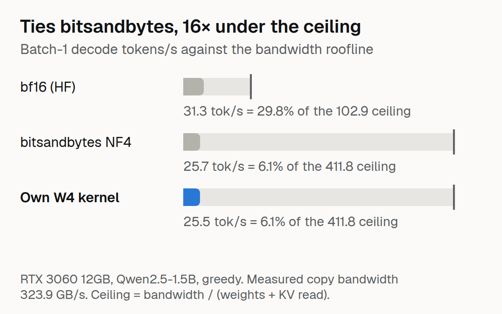

# Roofline-First Decoding

A fused 4-bit-weight dequantise-plus-GEMV Triton kernel for batch-1 LLM decoding, measured against the RTX 3060's memory-bandwidth roofline.

## The idea

Batch-1 decoding is memory-bandwidth bound: each token reads every weight byte once. So the ceiling on tokens/s is bandwidth divided by the bytes read per token, worked out before any code. Then: write the kernel, profile it, and explain with evidence how far each approach is from the physical limit and why.

Measured copy bandwidth (torch, not the spec sheet): **323.9 GB/s** (spec 360). The ceiling is `bandwidth / (weight bytes + KV-cache read at 2,048 tokens)`.

| Model | dtype | Weight GB | Ceiling tok/s |
|---|---|---|---|
| Qwen2.5-1.5B | bf16 | 3.087 | 102.9 |
| Qwen2.5-1.5B | int4 | 0.772 | 411.8 |
| ORCH-Fusion | bf16 | 0.550 | 539.7 |
| ORCH-Fusion | int4 | 0.137 | 2,158.8 |

## Results (Qwen2.5-1.5B-Instruct, batch-1 greedy, one RTX 3060 12GB)

| Setup | tok/s | Probe ppl | % of its roofline |
|---|---|---|---|
| bf16 (HF) | 31.3 | 12.91 | **29.8%** |
| bitsandbytes NF4 | 25.7 | 18.98 | 6.1% |
| **own W4 kernel (v3)** | **25.5** | **15.76** | 6.1% |

The kernel ties bitsandbytes on speed with lower probe perplexity, and both lose to bf16, which at ~30% of roofline is the best-engineered path here. Probe perplexity is four sentences (noisy), and bitsandbytes quantises different layers than my swap, so the perplexity gap is directional.

**A fairer denominator.** The 411.8 tok/s ceiling assumes every weight is int4, including the tied 151,936-token embedding / lm_head. In the swapped model that matrix stays bf16, so it reads 1.263 GB of weights per token (plus ~0.06 GB of KV cache). Against the bytes actually moved, 25.5 tok/s is about 34 GB/s, **~10% of measured bandwidth**, and the model's own ceiling is ~245 tok/s (a ~9.6× gap, not 16×). Both framings are in the repo's results files; the 6.1% figure is relative to the all-int4 ideal.

## The kernels

All three are correctness-tested against a PyTorch dequantise reference on the models' real matrix shapes before any number is reported.

- **v1** dequantise-then-matmul: materialises fp16, then torch matmul. The extra memory pass makes it 3-7× slower than v2.
- **v2** fused: one kernel, dequantise on the fly.
- **v3** split-K and tuned: explicit tuning (fresh buffer per trial, winner cached) and split-K parallelism for large matrices.

Two bugs found along the way, both load-bearing:

1. **Missing +8 zero-point** in packing: every positive weight destroyed. Caught in review before the first GPU run.
2. **`@triton.autotune` vs `atomic_add`**: autotune times all configs against the same output buffer, and a split-K kernel accumulates into it, so the buffer holds ~500 stale copies before the real launch. Fixed with explicit tuning.

### Kernel microbenchmarks (per layer shape, ms; lower is better)

| Shape (K x N) | Reference (fp16 weights) | v1 dequantise+matmul | v2 fused | v3 tuned / split-K |
|---|---|---|---|---|
| Qwen q-proj 1536 x 1536 | 0.092 | 0.203 | **0.049** | 0.053 |
| Qwen MLP gate 1536 x 8960 | 0.458 | 0.601 | **0.084** | 0.120 |
| Qwen MLP down 8960 x 1536 | 0.450 | 1.064 | **0.428** | 0.438 |
| ORCH attention 1024 x 1024 | 0.039 | 0.112 | **0.029** | 0.033 |
| ORCH MLP 1024 x 2816 | 0.103 | 0.178 | **0.029** | 0.035 |

The fused kernel (v2) is up to 5.5x faster than the reference on the wide MLP-gate shape, but **v3 is not faster than v2 on any of the five shapes** (v2 is 1.0-1.4x faster). End-to-end decoding uses v3, so swapping in v2 is a cheap follow-up experiment. The down-projection shape (tall K) barely beats the reference, which is part of why the end-to-end gain is small.

## Why 6-10% and not more

Per-layer breakdown: GEMV time is ~25 ms of the ~39 ms step; the rest is attention, norms, sampling and Python dispatch. Inside the GEMV the scalar nibble-unpack loop (shift, mask, subtract, scale per element, ~6 ALU ops per MAC, no pipelining) dominates. Marlin hides exactly this with async copies and software pipelining. A `tl.dot` rewrite was attempted and measured **4-7× slower**.

## Limitations

- Probe perplexity is 4 sentences. Single-prompt timing, batch-1, greedy only.
- No Marlin numbers (its kernels do not compile here: torch 2.13 / CUDA 13). No llama.cpp comparison.
- ORCH-Fusion end-to-end is not run (custom `.pt` checkpoint needs its own loader); its shapes are covered in microbenchmarks.
- A learning kernel: the point is understanding the gap, not beating Marlin.

## Structure

- `src/roofline/roofline.py`: exact weight counting, measured bandwidth, ceilings table
- `src/roofline/kernels.py`: v1 / v2 / v3
- `scripts/measure_roofline.py`: ceilings table · `scripts/bench_kernels.py`: per-shape latency and % of roofline · `scripts/decode_loop.py`: end-to-end decode and perplexity · `scripts/run_baselines.py`: bf16 and bitsandbytes
- Results: [raihan-js/roofline-decoding-results](https://huggingface.co/datasets/raihan-js/roofline-decoding-results). 46 tests (`PYTHONPATH=src pytest tests/`).

## License

MIT
